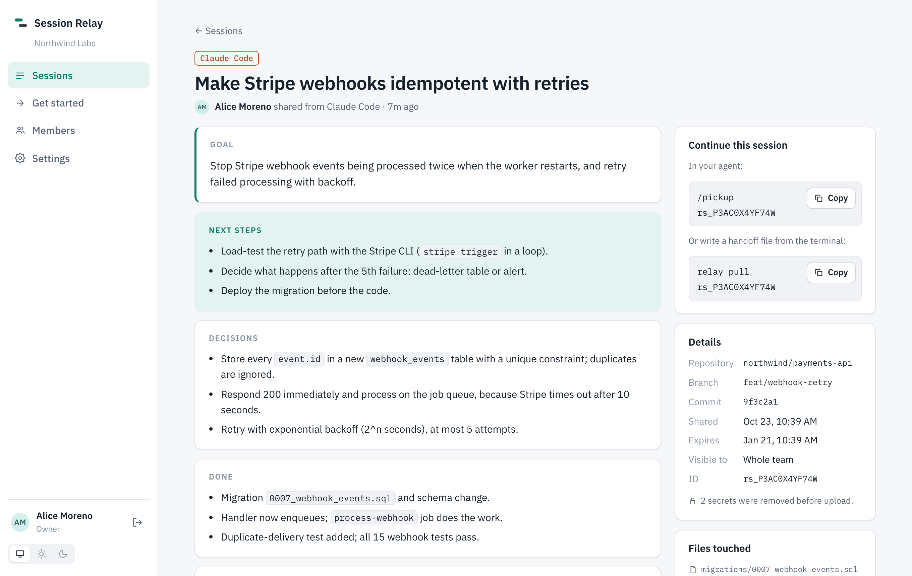

# Session Relay

**Pick up where your teammate left off.** Share coding-agent sessions across **Claude Code**, **OpenCode** and **Codex**. Your teammate continues in whichever tool they use, with the goal, decisions, next steps and recent conversation.

```
You (Claude Code):      /share
Teammate (OpenCode):    /pickup your webhook retry work
```



## Why

Handing off agent work means copy-pasting chat logs, or the next person starting from zero. With Session Relay:

- **`/share`**: the agent writes a handoff (goal, decisions, done, next steps, open questions) and shares it with the recent conversation and the files touched.
- **`/pickup`**: the next person's agent finds it, reads it, checks the code and continues, in any of the three tools.
- **Web app**: browse, search and read everything your team has shared.
- **Private by default**: nothing is uploaded unless you share it, secrets are removed on your laptop first, and shares can be limited to specific people.

## Hosting

| | |
|---|---|
| **Self-hosted** · available now | One `docker compose up` on your own server. Your data stays with you. → [Self-hosting guide](docs/self-hosting.md) |
| **Cloud** · coming soon | We run it for you: sign in with GitHub, invite your team, no server. → [Roadmap](docs/roadmap.md) |

## Quick start

**Run the server** (once per team):

```sh
git clone https://github.com/Ryrahul/session-relay.git && cd session-relay
cp deploy/.env.example deploy/.env          # set POSTGRES_PASSWORD, PUBLIC_URL, DOMAIN
docker compose -f deploy/docker-compose.yml --env-file deploy/.env up -d --build
docker compose -f deploy/docker-compose.yml --env-file deploy/.env exec server \
  node packages/server/dist/bootstrap.js --org "Your Team" --email you@your-team.com --name "You"
```

**Connect each laptop:**

```sh
npm install -g session-relay
relay login --server https://relay.your-team.com --token srk_...
relay setup        # adds /share and /pickup to Claude Code, OpenCode and Codex
```

Full walkthrough: [Getting started](docs/getting-started.md).

## Docs

- [Getting started](docs/getting-started.md): laptop setup, sharing, picking up
- [Self-hosting](docs/self-hosting.md): Docker, HTTPS, backups, upgrades
- [Agents](docs/agents.md): how each agent connects, manual setup, MCP tools
- [CLI reference](docs/cli.md)
- [Security & privacy](docs/security.md): what's uploaded, redaction, permissions
- [FAQ](docs/faq.md)
- [Roadmap](docs/roadmap.md)

## How it works

```
 Claude Code ─┐                         ┌─ web app (browse, search, read)
 OpenCode    ─┼─ relay CLI / relay mcp ─┼─ Relay server (Hono + Postgres)
 Codex       ─┘   read · redact · share └─ your team's agents via MCP
```

| Package | |
|---|---|
| `packages/cli` | `relay` CLI and MCP server: adapters for each agent, redaction, share building |
| `packages/server` | API: orgs, members, tokens, sessions, search, retention, audit |
| `packages/web` | Web app (React), served by the server |
| `packages/shared` | Session format and API types |

## Development

```sh
npm install
npm run dev:all             # Postgres in Docker + API on :8787 + web on :5173
npm run bootstrap:dev -- --org Dev --email you@example.com --name You
npm test                    # unit tests
npm run test:integration    # API against a throwaway Postgres
npm run test:e2e -- <repo>  # full stack, real agent sessions from <repo>, MCP client
```

Work on `feature/*` branches with PRs to `main`. Releases go `main` → `deploy`; see [deploy-pipeline.md](docs/deploy-pipeline.md).
